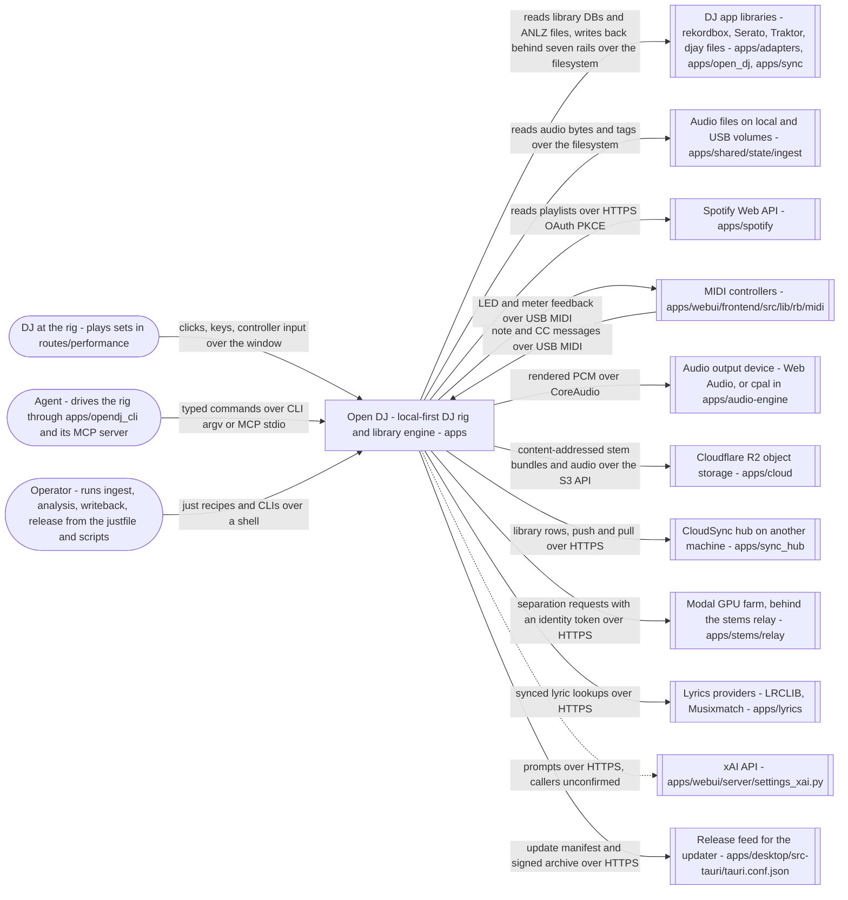

# C4 level 1: system context

*Describes commit `9f36f1b426`, Tue 27 Oct 2026. Conventions: [`README.md`](README.md).*

Open DJ is a local-first, agent-drivable DJ rig plus the library tooling under it. It runs on
the DJ's own machine: a desktop shell, a Python engine daemon, a SvelteKit interface and a Rust
audio engine (level 2 splits these apart). At this level it is one box, and the interesting part
is who drives it and what it reaches outside itself.

## Diagram

### Legend

| Shape | C4 element | In this diagram |
|:------|:-----------|:----------------|
| Stadium | Person | DJ, agent, operator |
| Rectangle | Software system in scope | Open DJ |
| Double-edged box | External software system | every other box |
| Dashed arrow | Optional or unconfirmed relationship | the xAI arrow |

## Users

**The DJ at the rig** uses `/performance` (`apps/webui/frontend/src/routes/performance/+page.svelte`),
a 4-deck clone of rekordbox 7 Performance mode, inside the desktop window or, in development, a
Chrome tab. Input arrives from the mouse, keyboard and a MIDI controller.

**The agent** is a first-class user, not an afterthought: every UI control must also exist as a
typed command (`docs/architecture.md`, "Agent-native parity"). The shipped entry point is
`apps/opendj_cli`, installed in the app as `payload/bin/opendj`; `opendj mcp` serves the same
verbs as a stdio MCP server (`apps/opendj_cli/README.md`, `apps/opendj_cli/mcp_server.py`).

**The operator** is the person or agent maintaining a library and a build: ingest
(`/ingest-tracks`), link repair (`/fix-links`), stems and vocals CLIs, vendor writeback with
`--live`, and the DMG release (`just dmg`, `scripts/release.sh`).

## External systems

| System | How Open DJ uses it | Where |
|:-------|:--------------------|:------|
| rekordbox | Read: a decrypted copy of `master.db` at `(private path)` plus ANLZ files via pyrekordbox. Write: gated writeback (playlists, ratings, cues, analysis) behind the seven-rail safety harness plus its rail 0 one-way import backstop. | `apps/shared/state/ingest/rekordbox.py`, `apps/adapters/rekordbox/`, `apps/sync/safety.py` |
| Serato, Traktor | Write-capable open-dj adapters | `apps/adapters/serato/`, `apps/adapters/traktor/` |
| djay | Read adapter, playlist writer, sync service | `apps/open_dj/adapters/djay.py`, `apps/sync/djay_writer.py`, `apps/sync/djay_sync_service.py` |
| Audio files and USB volumes | Folder import and rescan, USB export | `apps/shared/state/ingest/folder.py`, `apps/webui/server/routes/usb_*.py` |
| Spotify | Playlist import and an acquisition queue, OAuth Authorization Code with PKCE | `apps/spotify/` |
| MIDI controllers | Web MIDI in Chrome; a native CoreMIDI bridge in the installed Tauri shell, because WKWebView has no Web MIDI | `apps/webui/frontend/src/lib/rb/midi/webmidi.svelte.ts`, `apps/desktop/src-tauri/src/midi.rs`, ADR-NEW-native-midi-transport-for-installed-shell |
| Audio output device | Web Audio `destination` today; `odj-audio` through cpal when its opt-in mode is on; a native headphone cue sink in the Tauri shell | `apps/webui/frontend/src/lib/rb/audio-engine.svelte.ts`, `apps/audio-engine/src/device.rs`, `apps/desktop/src-tauri/src/cue_sink.rs` |
| Cloudflare R2 | Content-addressed asset store for stem bundles and audio; Litestream replication of `state.db` is configured | `apps/cloud/asset_store.py`, `apps/cloud/r2_keys.py`, `apps/cloud/litestream.yml` |
| CloudSync hub | Another Open DJ engine started with `MDT_IS_HUB=1`; spokes converge library rows with it | `apps/sync_hub/hub_deploy.py`, `apps/sync_hub/client.py` |
| Modal | GPU stem separation. The app holds no Modal secret: it calls a relay that verifies, allowlists and meters, and only the relay calls Modal | `apps/stems/routing.py`, `apps/stems/relay/client.py`, `apps/stems/relay/app.py` |
| Lyrics providers | Line-synced lyrics fetched and cached by stable track id | `apps/lyrics/` |
| xAI API | Named as an endpoint in the AI settings module | `apps/webui/server/settings_xai.py` |
| Release feed | Tauri updater endpoint and minisign public key; the public manifest lives outside this repository | `apps/desktop/src-tauri/tauri.conf.json`, `scripts/release.sh` |

Demucs and RoFormer separation also run locally, without Modal, as standalone PEP 723 worker
scripts (`scripts/stem_bundle_worker.py`), so heavy ML never enters the repo venv. That is a
process inside Open DJ, not an external system, and level 2 draws it.

## Unconfirmed at this level

- **xAI callers.** `settings_xai.py` names `https://api.x.ai/v1`; which features send prompts
  through it was not traced. The arrow is dashed.
- **Litestream in production.** `apps/cloud/litestream.yml` exists; whether any machine runs it
  continuously today was not established from the tree.
- **Syncthing.** `apps/cloud/README.md` describes a Syncthing bootstrap for audio folders. I did
  not find it started by any shipped process, so it is not drawn.
- **Where the stems relay is hosted.** `apps/stems/relay/app.py` says it is deployed on a
  server the operator controls and is not shipped in the app; the host is not in the tree.
- **The Modal worker itself.** The routing and relay contract are in the tree; the deployed Modal
  app was not read.
