# C4 level 2: containers

*Describes commit `9f36f1b426`, Tue 27 Oct 2026. Conventions: [`README.md`](README.md).*

This is the most important diagram in the set. It shows every process and data store Open DJ
runs on the DJ's machine, plus the two server-side containers that live elsewhere, and labels
each arrow with what moves, over what, and in which direction.

## Which desktop shell is current

**Tauri 2 (WKWebView) is the shipping shell. Electron is built beside it and has not been cut
over.** Evidence at this commit:

- `apps/desktop/electron/README.md`: "built beside the Tauri shell (`../src-tauri/`), which
  keeps shipping until the cutover plan 21-02". ADR-NEW-electron-desktop-shell has status
  "proposed (plan 21-01 built beside Tauri; the cutover is plan 21-02)".
- `(private path)/` holds `21-01-PLAN.md` and `21-01-SUMMARY.md`
  only; there is no 21-02 plan or summary in this tree.
- `just dmg` (`justfile`, recipe `dmg`) stages the payload into `apps/desktop/src-tauri/payload`
  and builds with `cargo tauri build`; neither the recipe nor `scripts/ship_dmg.sh` mentions
  Electron.
- The Electron `pack:dir` build ships an empty placeholder payload
  (`apps/desktop/electron/payload/README.md`), so it cannot run the product without a checkout.
- The web UI talks to whichever shell hosts it through `apps/webui/frontend/src/lib/shell/native-shell.ts`, which
  has both a Tauri branch and an Electron `window.opendjShell` branch.

So the diagram draws Tauri as the shell and Electron dashed.

## Diagram

```mermaid
flowchart TB
    dj(["DJ at the rig"])
    agent(["Agent"])

    subgraph mac["DJ machine - Open DJ"]
        shell["Desktop shell - Tauri 2, Rust - apps/desktop/src-tauri"]
        electron["Electron shell, not shipped yet - TypeScript - apps/desktop/electron"]
        spa["Web UI and Web Audio engine - SvelteKit, Svelte 5 - apps/webui/frontend"]
        daemon["Engine daemon - Python, FastAPI - apps/engine_core over apps/webui/server"]
        odjaudio["odj-audio - Rust audio engine process - apps/audio-engine"]
        cli["opendj CLI and MCP server - Python - apps/opendj_cli"]
        workers["Heavy-ML workers - PEP 723 scripts - scripts/stem_bundle_worker.py, scripts/vocal_region_worker.py"]
        statedb[("state.db - SQLite WAL - (private path), apps/shared/state")]
        jobsdb[("jobs.db - SQLite - data_dir/state/jobs.db, apps/engine_core/jobs")]
        caches[("Derived artifacts - files - (private path), stems, vocal-cache, local-waveform-cache")]
        rbcopy[("rekordbox decrypted copy and ANLZ - files - (private path)")]
    end

    vendor[["DJ app libraries and audio files"]]
    midi[["MIDI controller"]]
    device[["Audio output device"]]
    hub["CloudSync hub - engine daemon with MDT_IS_HUB=1 - apps/sync_hub"]
    relay["Stems relay - Python - apps/stems/relay/app.py"]
    r2[["Cloudflare R2"]]
    modal[["Modal GPU farm"]]

    dj -->|input events over the window| shell
    agent -->|verbs over argv or MCP stdio| cli

    shell -->|spawns payload/bin/opendj-engine with data dir and port, polls health over HTTP| daemon
    shell -->|hosts the page in WKWebView, injects the engine origin| spa
    shell -->|raw MIDI bytes over Tauri IPC events| spa
    midi -->|MIDI over CoreMIDI via midir| shell
    spa -->|cue bus PCM over a loopback link| shell
    shell -->|headphone cue PCM over CoreAudio| device
    electron -.->|same lifecycle contract, cutover pending| daemon

    spa -->|JSON over HTTP api/v1, the OpenAPI surface| daemon
    spa -->|audio bytes and ANLZ over HTTP GET tracks audio and anlz| daemon
    daemon -->|invalidation events over WebSocket api/v1/events| spa
    spa -->|claims agent orders over an HTTP long poll on api/v1/commands/next, posts results| daemon
    spa -->|UI mirror projection over HTTP PUT api/v1/state/ui-mirror| daemon
    spa -->|mixed PCM over Web Audio destination| device

    cli -->|orders and queries over HTTP api/v1/commands and other routes| daemon

    daemon -.->|spawns with a per-spawn token, protocol v1 NDJSON over stdio| odjaudio
    daemon -->|decode and probe subcommands, PCM over stdout| odjaudio
    spa -.->|commands in, 30 Hz state out, protocol v1 over loopback WebSocket api/v1/ws| odjaudio
    odjaudio -.->|rendered PCM over cpal CoreAudio| device

    daemon -->|rows over SQLite through StateWriter| statedb
    daemon -->|job rows over SQLite| jobsdb
    daemon -->|reads and writes cache files over the filesystem| caches
    daemon -->|reads djmdContent and djmdCue over SQLite, ANLZ over the filesystem| rbcopy
    daemon -->|reads library files, seven-rail writeback over the filesystem| vendor
    daemon -->|spawns, JSON lines over stdout| workers
    workers -->|stem bundles and vocal regions over the filesystem| caches

    daemon -->|library rows over HTTPS, CloudSync protocol| hub
    daemon -->|content-addressed bytes over the S3 API and presigned URLs| r2
    daemon -->|separation request and identity token over HTTPS polling| relay
    relay -->|GPU job over the Modal API| modal
```

### Legend

| Shape | C4 element | In this diagram |
|:------|:-----------|:----------------|
| Stadium | Person | DJ, agent |
| Rectangle | Container | shell, Electron shell, web UI, daemon, odj-audio, CLI, workers, hub, relay |
| Cylinder | Data store container | state.db, jobs.db, derived artifacts, rekordbox copy |
| Double-edged box | External software system | vendor libraries, MIDI controller, audio device, R2, Modal |
| Dashed arrow | Opt-in or not yet the default path | Electron, every odj-audio playback arrow |

## Containers

| Container | Technology | Directory | How it starts |
|:----------|:-----------|:----------|:--------------|
| Desktop shell | Tauri 2, Rust, WKWebView | `apps/desktop/src-tauri` | The `.app` binary. Starts or adopts the engine (`launch.rs`), supervises it (`supervisor.rs`), keeps one instance, creates the window with background throttling disabled (`main.rs`). `OPENDJ_ENGINE_ORIGIN` attaches to an existing engine instead of spawning. |
| Electron shell | Electron, TypeScript | `apps/desktop/electron` | `pnpm e2e` or `pnpm pack:dir`; not in the shipped DMG. |
| Web UI and Web Audio engine | SvelteKit, Svelte 5, Web Audio, AudioWorklet | `apps/webui/frontend` | Dev: Vite (`just webui-frontend`). Packaged: the built SPA under `app/apps/webui/frontend/build`, served by the daemon's SPA mount. |
| Engine daemon | Python 3, FastAPI, uvicorn | `apps/engine_core`, wrapping `apps/webui/server` | Packaged: `payload/bin/opendj-engine` runs `python -m apps.engine_core serve`. Dev: `just engine-serve` (chassis) or `just webui-backend` (bare `python -m apps.webui.server`). |
| odj-audio | Rust, symphonia, cpal, tungstenite, Signalsmith Stretch | `apps/audio-engine` | Spawned by `apps/engine_core/audio_engine.py` when `ODJ_AUDIO_ENGINE` is `wall` or `device`, or on `POST /api/v1/audio-engine/start`. Off by default. Also run as a one-shot `decode` or `probe` by analysis (`apps/shared/engine_decode.py`). |
| opendj CLI and MCP | Python, httpx | `apps/opendj_cli` | `payload/bin/opendj` in the app; `opendj mcp` for stdio MCP. Finds the engine origin from the lock file (`apps/opendj_cli/origin.py`). |
| Heavy-ML workers | PEP 723 scripts, torch, demucs | `scripts/` | Spawned per job by `apps/stems` and `apps/vocals`; under `uv run` in a checkout, under the payload runtime when packaged. |
| state.db | SQLite, WAL | `(private path)`; schema and writer in `apps/shared/state` | Opened by the daemon; `SqliteBackend` when present, else `InMemoryBackend`. |
| jobs.db | SQLite | `<data_dir>/state/jobs.db` | Kept apart from `state.db` so a jobs migration cannot corrupt it (`apps/engine_core/config.py`). |
| Derived artifacts | Files | `(private path)/` subdirectories | Written by the daemon and workers, never operator files. |
| CloudSync hub | Same engine, `MDT_IS_HUB=1` | `apps/sync_hub` | A headless `python -m apps.engine_core serve` on another machine (`apps/sync_hub/hub_deploy.py`). |
| Stems relay | Python | `apps/stems/relay` | Deployed on a server, not shipped; only `contract.py` and `client.py` reach the app. |

## Protocols worth knowing

- **HTTP and the OpenAPI surface.** Everything the page and the CLI ask of the daemon is JSON over
  loopback HTTP under `/api/v1`. The generated contract is `apps/webui/openapi.json` (364 paths at
  this commit), dumped by the `engine_openapi_dump` expression in the `justfile`; the frontend's
  typed client is `apps/webui/frontend/src/lib/api-types.ts`. Routers are mounted in
  `apps/webui/server/app_wiring.py` (`_mount_api_routers`). Security is loopback binding plus a
  CORS allowlist (`_configure_cors`), not authentication.
- **The IPC dispatcher.** Inside the page, `apps/webui/frontend/src/lib/rb/performance-ipc.svelte.ts` is the single
  validated path for every control. Agent orders reach it by a hand-off: the CLI `POST`s
  `/api/v1/commands`, the daemon holds the order (`apps/webui/server/routes/commands.py`), the one
  leader tab claims it on a long poll and runs it through the same dispatcher, then posts the
  result. An order no leader claims in time is answered `503 no_leader`.
- **The audio engine socket.** `odj-audio serve --ws` binds loopback only, needs
  `ODJ_AUDIO_WS_TOKEN`, and serves `/api/v1/ws?token=...`. The daemon mints the token per spawn and
  publishes URL and token at `GET /api/v1/audio-engine`; the page connects directly, so the state
  feed skips Python (ADR-NEW-audio-engine-socket-and-supervisor).
- **SQLite.** Only `StateWriter` (`apps/shared/state/writer.py`) is the sanctioned writer; each write
  appends to the `events` table in the same transaction.
- **Files.** ANLZ, stems, vocal cache and waveform cache are plain files under `(private path)/`.
  Vendor files are read freely and written only through the seven rails (plus the rail 0 backstop) in `apps/sync/safety.py`.
- **MIDI.** Web MIDI in Chrome; the CoreMIDI bridge (`native_midi_snapshot`, `native_midi_send`) in
  the Tauri shell. Mapping and actions stay in TypeScript either way.

## Unconfirmed

- **Rust engine in the packaged app.** I did not find `ODJ_AUDIO_ENGINE` set by the Tauri shell or
  the payload launchers, and the page needs `?engine=rust` to use it
  (`apps/webui/frontend/src/lib/audio-engine/rust-mode.svelte.ts`). So by default users hear Web Audio and the playback
  arrows to `odj-audio` are dashed. The payload builds `odj-audio` with `--features device` only, so
  the engine's own MIDI input (`apps/audio-engine/src/midi_in.rs`, feature `midi`) is not in the
  shipped binary.
- **ffmpeg.** ADR-NEW-analysis-decodes-with-the-engine says "Do not bundle ffmpeg", yet
  `scripts/build_engine_payload.py` stages a pinned LGPL `bin/ffmpeg` and exports `ODJ_FFMPEG_BIN`.
  Which analysis lanes still decode through ffmpeg was not traced.
- **rekordbox copy in the packaged app.** How an installed app obtains the decrypted rekordbox data
  (versus `(private path)` in a checkout) was not traced.
- **Daemon background work.** `docs/architecture.md` says there are no background workers; at this
  commit `app_wiring.py` starts armed schedulers (CloudSync, stem cache enforcer, coverage drain,
  ahead analysis, library jobs watcher) in its lifespan. They are inside the daemon container, so
  the diagram is unaffected; the older prose is stale on this point.
