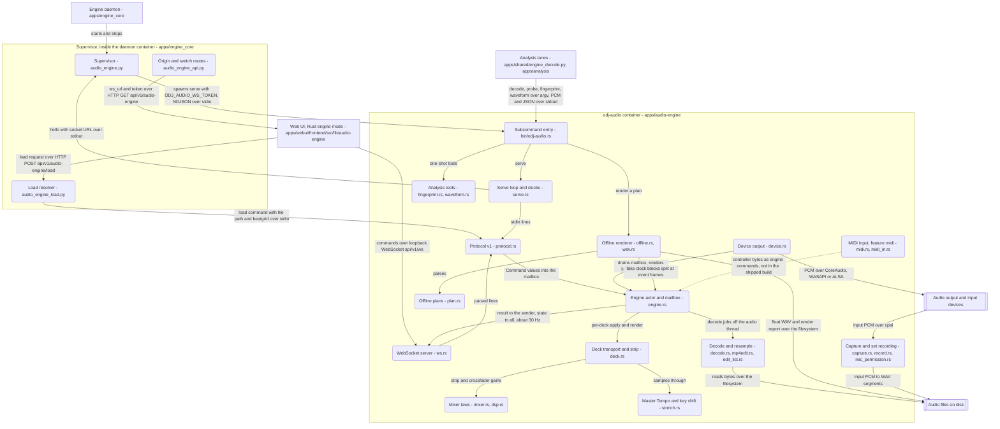

# C4 level 3: components of the Rust audio engine

*Describes commit `9f36f1b426`, Tue 27 Oct 2026. Container: "odj-audio" in
[`c4-2-containers.md`](c4-2-containers.md). Paths are relative to `apps/audio-engine/src/`
unless they start with `apps/`.*

`odj-audio` is a standalone Rust binary with no shell dependency (ADR-NEW-rust-audio-engine-process).
One actor owns all playback state; the UI, MIDI, agents and the CLI are equal senders into its
mailbox, and it applies their commands in arrival order at block boundaries. It runs in three
shapes: a long-lived `serve` process supervised by the Python daemon, an offline `render` of a
plan on a fake clock, and one-shot tools (`decode`, `probe`, `fingerprint`, `waveform`,
`input-devices`, `record`, `version`) that the analysis lanes call
(`bin/odj-audio.rs`, ADR-NEW-analysis-decodes-with-the-engine).

It is not yet what users hear by default: the page plays through Web Audio unless Rust engine mode
is on (`?engine=rust`), and the daemon does not start the engine unless `ODJ_AUDIO_ENGINE` is
`wall` or `device` or a client calls `POST /api/v1/audio-engine/start`.

Agent modability zones (RED / ORANGE / GREEN) for these paths:
`(private path)`.

## Diagram

### Legend

| Shape | C4 element | In this diagram |
|:------|:-----------|:----------------|
| Rectangle | Container outside this one | daemon, page, analysis lanes |
| Double-edged box | External system | audio files, audio devices |
| Rounded box | Component | supervisor modules and every engine module |
| Dashed arrow | Not in the shipped build | engine MIDI input |

The supervisor modules live in the daemon container; they are drawn here because they are the
engine's only lifecycle owner.

## Components

| Component | Responsibility | Files |
|:----------|:---------------|:------|
| Subcommand entry | `serve`, `render`, `decode`, `probe`, `fingerprint`, `waveform`, `input-devices`, `record`, `version` | `bin/odj-audio.rs`, `lib.rs` |
| Serve loop and clocks | Long-lived process on stdio. Three clocks drive one engine: the device callback (feature `device`), a wall clock into a null sink, and a fake clock that renders only when told to (stdio only, no socket) | `serve.rs` |
| WebSocket server | `serve --ws ADDR`: loopback only, `/api/v1/ws` only, `?token=` required, at most 16 clients, one blocking thread per client polled every 2 ms; a client that stops reading is dropped | `ws.rs` |
| Protocol v1 | Newline-delimited JSON: `{id, cmd}` in; `hello`, `result`, `state` out. Commands are the audio subset of the page's `PerformanceCommand`, same names and 0..1 units. Only stdio may send `engine_shutdown` | `protocol.rs` |
| Engine actor | The single owner of playback state; `apply` one command at a time in mailbox order, `render` pulls audio. Zero allocations in both, enforced by a counting-allocator test | `engine.rs` |
| Deck | A decoded track, transport, cue, loop, channel strip; progressive load swaps a decoded head for the whole track without moving the playhead (ADR-NEW-progressive-deck-load) | `deck.rs` |
| Mixer laws | Knob curves and biquads copied from the Web Audio engine so the two can be null-tested on the same plan; they must change together | `mixer.rs`, `dsp.rs` |
| Stretch | Master Tempo and key shift through the upstream Signalsmith Stretch library | `stretch.rs` |
| Decode | symphonia decode to stereo f32, resampled once (streaming resampler), MP4 edit lists applied so m4a starts on its first real sample | `decode.rs`, `mp4edit.rs`, `edit_list.rs` |
| Device output | cpal callback is the audio thread: drains the mailbox, renders, maps stereo onto the device channels | `device.rs` |
| Offline plans and renderer | A plan is a timeline of commands at absolute times or bar positions on a deck's own grid; rendered as fast as the CPU allows, byte-identical for the same plan whatever the block size, with a report of what a scorer needs | `plan.rs`, `offline.rs`, `wav.rs` |
| Capture and recording | Input devices, rolling 16-bit WAV segments named by UTC start for `apps/sets`, the macOS microphone permission | `capture.rs`, `record.rs`, `mic_permission.rs` |
| Analysis tools | Chromaprint-compatible fingerprints for `apps/dedup`; tri-band waveform peaks with the same contract as `apps/analysis_waveform/decode.py` | `fingerprint.rs`, `waveform.rs` |
| MIDI input | Decodes controller bytes with the page's own device maps (`apps/audio-engine/maps`) | `midi.rs`, `midi_in.rs` |
| Supervisor | Spawns with a fresh `secrets.token_urlsafe(32)` token, learns the socket URL from `hello`, restarts with backoff and a new token, counts `generation`; `ODJ_AUDIO_BIN` wins, else the newest local cargo build | `apps/engine_core/audio_engine.py` |
| Origin route | `GET /api/v1/audio-engine` publishes state, clock, `ws_url`, token; `start`, `stop`, `load` beside it | `apps/engine_core/audio_engine_api.py` |
| Load resolver | Turns a `stable_id` into a `load` with the same file `GET /tracks/{id}/audio` streams and the beatgrid `/anlz` serves | `apps/engine_core/audio_engine_load.py` |

## Rules that hold across the components

- **The audio thread never touches a socket or the client table**, and never allocates. Replaced
  tracks leave the audio thread to be freed.
- **Determinism**: same plan, same bytes; events fire on exact frames.
- **What is not built is refused, never faked**: unbuilt commands return `not_implemented` naming
  the plan that brings them, and `hello` lists them so the page grays those controls out.
- **Audio does not outlive a Python crash** today: the daemon is the engine's parent. Whether it
  should is left to switch-over, plan 20-07.

## Unconfirmed

- **Which commands are still `not_implemented`** at this commit (the rust-mode header names keylock,
  stems and the headphone cue bus as not built, but `stretch.rs` exists). The live list is the
  engine's `hello`; it was not run for this file.
- **MIDI in the shipped binary.** `scripts/build_engine_payload.py` builds with `--features device`
  only, so I drew `midi_in.rs` as absent from the shipped build. Whether a later recipe enables
  `midi` was not found.
- **Cue bus and device routing** (plan 20-06): `device.rs` says outputs past 2 stay silent until the
  cue bus lands; not re-checked against later plans.
