# C4 level 3: components of the engine daemon

*Describes commit `9f36f1b426`, Tue 27 Oct 2026. Container: "Engine daemon" in
[`c4-2-containers.md`](c4-2-containers.md). Area maps: [`../../moc/engine-core.md`](../../moc/engine-core.md),
[`../../moc/webui-server.md`](../../moc/webui-server.md).*

The daemon is one Python process with two layers. `apps/engine_core` is the **process chassis**,
not the audio engine (the engine-core MOC's trap T1): it takes the single-instance lock, applies
the environment contract, builds the legacy FastAPI app from `apps/webui/server`, and adds a
versioned `/health`, a jobs subsystem, a WebSocket invalidation bus, account and setup routes,
and the Rust engine supervisor. Underneath, `apps/webui/server` holds the routers, the state
backend and the rekordbox asset path, and imports the April-era domain packages under `apps/`.

## Diagram

```mermaid
flowchart TB
    spa["Web UI - apps/webui/frontend"]
    cli["opendj CLI and MCP - apps/opendj_cli"]
    shell["Desktop shell - apps/desktop/src-tauri"]
    odjaudio["odj-audio - apps/audio-engine"]
    workers["Heavy-ML workers - scripts"]
    statedb[("state.db - (private path)")]
    jobsdb[("jobs.db - data_dir/state/jobs.db")]
    caches[("Derived artifacts - (private path)")]
    rbcopy[("rekordbox copy and ANLZ - (private path)")]
    vendor[["DJ app libraries and audio files"]]
    remote[["CloudSync hub, R2, stems relay, Spotify, lyrics providers"]]
    ledger[("Progress ledger - (private path)")]

    subgraph d["Engine daemon container - apps/engine_core over apps/webui/server"]
        main("Entry, env contract, lock - engine_core/__main__.py, config.py, lock.py")
        chassis("Chassis app, health, SPA mount last - engine_core/app.py")
        wiring("App wiring, CORS, routers, lifespan schedulers - webui/server/app.py, app_wiring.py")
        routes("Route modules under api/v1 - webui/server/routes")
        cmds("Agent order bus - routes/commands.py, shell_commands.py")
        progress("Progress ledger routes - routes/progress.py")
        wsbus("Invalidation bus - engine_core/ws.py")
        jobs("Background jobs - engine_core/jobs")
        setup("Setup, account, rescue - engine_core/setup, account, rescue")
        aesup("Audio engine supervisor - engine_core/audio_engine.py, audio_engine_api.py")
        backend("State backend - webui/server/backend.py, sqlite_backend.py")
        rbv("Rekordbox asset path - webui/server/rb_vendor.py, rb_vendor_pkg")
        state("State layer and single writer - apps/shared/state")
        ingest("Ingest adapters - apps/shared/state/ingest")
        writers("Seven-rail vendor writers - apps/sync, apps/adapters, apps/smartlists")
        analysis("Analysis lanes and queue - apps/analysis, analysis_beatgrid, analysis_key, analysis_loudness, analysis_structure, analysis_waveform")
        stemsv("Stems and vocals - apps/stems, apps/vocals")
        cloud("CloudSync and assets - apps/sync_hub client, apps/cloud")
        domain("Other domain packages - apps/lyrics, spotify, dj_copilot, smartlists, pairings, dedup, reconcile")
        errs("Typed errors and request guard - webui/server/errors.py, request_guard.py")
    end

    shell -->|starts with data dir and port, polls health over HTTP| main
    main -->|takes lock then builds| chassis
    chassis -->|create_app| wiring
    wiring -->|mounts| routes
    spa -->|JSON and bytes over HTTP api/v1| routes
    cli -->|orders and queries over HTTP| routes
    spa -->|long-poll claim and result over HTTP| cmds
    cli -->|POST api/v1/commands, held until a page claims| cmds
    wsbus -->|seq-numbered invalidations over WebSocket api/v1/events| spa
    routes -->|reads and writes| backend
    backend -->|EAV rows| state
    state -->|SQL in one SAVEPOINT with an events row| statedb
    routes -->|track, anlz, audio lookups| rbv
    rbv -->|djmdContent, djmdCue over SQLite, ANLZ over files| rbcopy
    rbv -->|anlz-cache, waveform cache over files| caches
    ingest -->|vendor rows into StateWriter| state
    ingest -->|reads library DBs and folders| vendor
    routes -->|writeback requests| writers
    writers -->|backup, atomic write, readback over files| vendor
    routes -->|enqueue| jobs
    jobs -->|job rows| jobsdb
    jobs -->|one subprocess per job in its own process group| workers
    routes -->|analysis requests| analysis
    analysis -->|decode and probe over argv and stdout| odjaudio
    analysis -->|records| state
    routes -->|stem and vocal requests| stemsv
    stemsv -->|spawns PEP 723 workers| workers
    stemsv -->|bundles and vocal cache| caches
    wiring -->|armed CloudSync scheduler| cloud
    cloud -->|rows and bytes over HTTPS and the S3 API| remote
    domain -->|HTTPS lookups| remote
    routes -->|domain calls| domain
    aesup -->|spawn, token, stdio| odjaudio
    progress -->|atomic YAML writes| ledger
    routes -->|raise| errs
```

### Legend

| Shape | C4 element | In this diagram |
|:------|:-----------|:----------------|
| Rectangle | Container outside this one | web UI, CLI, shell, odj-audio, workers |
| Cylinder | Data store container | state.db, jobs.db, derived artifacts, rekordbox copy, progress ledger |
| Double-edged box | External system | vendor libraries, remote services |
| Rounded box | Component | everything inside the daemon subgraph |

## Components

| Component | Responsibility | Files |
|:----------|:---------------|:------|
| Entry, env contract, lock | `python -m apps.engine_core serve --data-dir --host --port`. Sets `MDT_DATA_DIR` before any `apps.webui` import, because legacy modules resolve paths at import time; takes the `flock` on `<data_dir>/.engine.lock` before binding a socket | `apps/engine_core/__main__.py`, `config.py`, `lock.py` |
| Chassis app | Wraps `create_app` from `apps/webui/server`, wraps `/health` with `contract_rev`, `engine_version`, `boot_id`, adds jobs and events, mounts the SPA last because a root mount shadows later routes | `apps/engine_core/app.py` |
| App wiring | CORS allowlist, bind warning, exception handlers, router mounts under `/api/v1`, and a lifespan that starts armed schedulers (CloudSync, stem cache enforcer, coverage drain, ahead analysis, library jobs watcher) | `apps/webui/server/app.py`, `apps/webui/server/app_wiring.py` |
| Route modules | 121 files at this commit; the served surface is `apps/webui/openapi.json` (364 paths) | `apps/webui/server/routes/` |
| Agent order bus | Holds `POST /commands` until the leader page claims it on `GET /commands/next?wait_ms=N`; `503 no_leader` when nobody claims; shell navigation requests for the installed window | `routes/commands.py`, `shell_commands.py`, `routes/shell.py` |
| Progress ledger | Serves and mutates the fan-out ledger with git SHA provenance; never commits | `routes/progress.py`, `(private path)` |
| Invalidation bus | WebSocket hub with a 256-entry queue; clients that see a `seq` gap refetch over HTTP, there is no replay | `apps/engine_core/ws.py` |
| Background jobs | Own `jobs.db`; a job running under a prior boot becomes `unknown`, never a guessed `failed`; cancel kills the process group | `apps/engine_core/jobs/` |
| Setup, account, rescue | First-run wizard, entitlements and feature flags, the crash-rescue ring | `apps/engine_core/setup/`, `account/`, `rescue/` |
| Audio engine supervisor | Owns the `odj-audio` lifecycle and publishes its socket | `apps/engine_core/audio_engine.py`, `audio_engine_api.py`, `audio_engine_load.py` |
| State backend | `StateBackend` protocol; `SqliteBackend` over `state.db`, `InMemoryBackend` in tests | `apps/webui/server/backend.py`, `sqlite_backend.py` |
| Rekordbox asset path | `stable_id` to vendor ids to `master.plain.db` rows, cues from `djmdCue` never ANLZ PCOB, ANLZ tri-band and PQTZ, own-analysis overlays, per-path cache locks | `apps/webui/server/rb_vendor.py`, `apps/webui/server/rb_vendor_pkg/` |
| State layer | Schema and migrations, WAL, three-tier `stable_id`, `StateWriter` as the sanctioned writer, durable `events` | `apps/shared/state/schema.py`, `db.py`, `ids.py`, `writer.py`, `events.py` |
| Ingest adapters | rekordbox and folder import, rescan, tag refresh | `apps/shared/state/ingest/` |
| Seven-rail writers | Rail 0 one-way import backstop (rekordbox), then backup, running-app check, typed confirm, post-write readback, incremental reversal script, reason field, iCloud quiesce (djay only); dry-run default is a writer convention, not a rail | `apps/sync/safety.py`, `apps/sync/playlist_apply.py`, `apply_cues.py`, `apply_ratings.py`, `apps/adapters/`, `apps/smartlists/writers.py` |
| Analysis | Lane queue with a worker pool where the record write and the move to `done` are one transaction; own beatgrid, key, loudness, structure, waveform | `apps/analysis/queue_runner.py`, `apps/analysis_*` |
| Stems and vocals | Precomputed bundles, Modal or local routing, R2 hydration, vocal regions from stems | `apps/stems/`, `apps/vocals/` |
| CloudSync and assets | Spoke client of the hub protocol, content-addressed R2 asset store, hydration order pinned, cache, presigned URL | `apps/sync_hub/client.py`, `apps/cloud/` |
| Typed errors | `NotFoundError` 404, `ConflictError` 409 with an `ETag`, `BackendError` 422; origin checks for unsafe requests | `apps/webui/server/errors.py`, `request_guard.py` |

## Parity

`PARITY-TODO.md` is the board of what is shipped versus pending; it is a document, not an
endpoint. Measured parity against rekordbox ground truth is the `apps/parity` CLI
(`python -m apps.parity score --payload FILE`), which scores BPM, key, waveform, phrase, cues and
vocal lanes. I did not find a route that serves parity scores, so none is drawn.

## Unconfirmed

- **Which route modules call which domain package.** The arrows from "Route modules" to the domain
  components are drawn at package granularity from the route file names and `app_wiring.py`
  imports, not from a call graph.
- **`apps/engine_core/store/schema.py` on the boot path.** The engine-core MOC (gap 1) left open
  whether the consolidated schema runs on a real boot; this file did not settle it, so the state
  layer is drawn as `apps/shared/state`.
- **The direct-SQL exceptions to the single writer** listed in `(private path)`
  (Sat 15 Aug 2026) were not re-counted.
