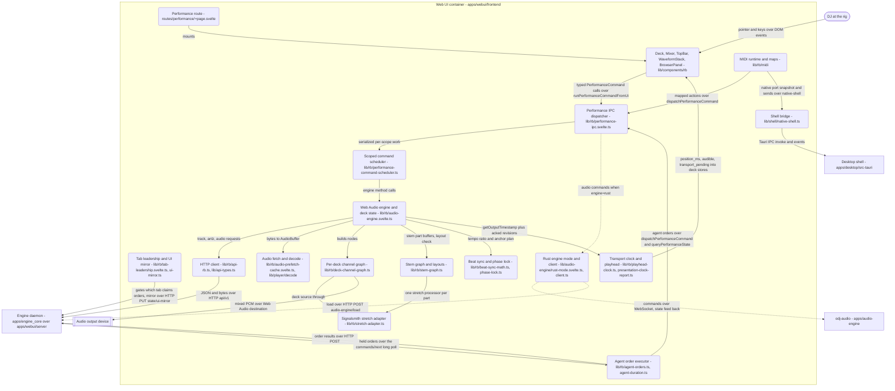

# C4 level 3: components of the performance rig

*Describes commit `9f36f1b426`, Tue 27 Oct 2026. Container: "Web UI and Web Audio engine" in
[`c4-2-containers.md`](c4-2-containers.md). Paths below are relative to
`apps/webui/frontend/src/` unless they start with `apps/`.*

The rig is the `/performance` route of the SvelteKit app. It is a UI and, by default, also the
audio engine: decks are decoded, scheduled and mixed in Web Audio inside the page. The one rule
that shapes it is agent-native parity: every control goes through one dispatcher that agents use
too (`docs/architecture.md`, "Agent-native parity, the load-bearing constraint").

## Diagram

### Legend

| Shape | C4 element | In this diagram |
|:------|:-----------|:----------------|
| Stadium | Person | DJ |
| Rectangle | Container outside this one | daemon, odj-audio, desktop shell |
| Double-edged box | External software system | audio device |
| Rounded box | Component | everything inside the web UI subgraph |
| Dashed arrow | Opt-in path | Rust engine mode, off unless `?engine=rust` |

## Components

| Component | Responsibility | Files |
|:----------|:---------------|:------|
| Performance route | Mounts the 4-deck layout and owns route teardown | `routes/performance/+page.svelte`, `lib/rb/performance-route-teardown.ts` |
| Panels | TopBar, WaveformStack, four Decks around the Mixer, BrowserPanel, QuickDrawMenu | `lib/components/rb/Deck.svelte`, `Mixer.svelte`, `TopBar.svelte`, `WaveformStack.svelte`, `BrowserPanel.svelte`, `QuickDrawMenu.svelte` |
| IPC dispatcher | The single validated, serialized dispatch, query and capture path, shared by UI, MIDI and agents. A control wired around it is a defect. | `lib/rb/performance-ipc.svelte.ts` (`dispatchPerformanceCommand`, `runPerformanceCommandFromUi`) |
| Command scheduler | Runs commands that share a scope in order, lets independent decks proceed, invalidates stale work on route change | `lib/rb/performance-command-scheduler.ts` |
| Agent order executor | Claims orders the daemon holds (`single`, `sequence`, `parallel`, `ramp`) on a 20 s long poll and runs them through the dispatcher. This is the agent-plan executor: multi-step plans with durations, run by the page, not by the daemon. | `lib/rb/agent-orders.ts`, `lib/rb/agent-duration.ts`, daemon side `apps/webui/server/routes/commands.py` |
| Tab leadership and UI mirror | Exactly one `/performance` tab per engine claims orders and publishes the mirror: Web Locks inside one browser, a server lease across browsers | `lib/rb/tab-leadership.svelte.ts`, `lib/rb/tab-leadership.ts`, `lib/rb/ui-mirror.ts`, `apps/webui/server/routes/state.py` |
| Web Audio engine | Per-deck `DeckState` stores, load, transport, cues, loops, quantize, mixer state. The largest hand-written frontend module (4,446 lines). | `lib/rb/audio-engine.svelte.ts`, `lib/rb/audio-engine-types.ts` |
| Channel graph | Source, TRIM, three-band EQ (250 Hz, 1200 Hz, 5 kHz), channel fader, crossfader, master | `lib/rb/deck-channel-graph.ts` |
| Stretch adapter | Typed boundary around the pinned `signalsmith-stretch` worklet; Master Tempo and key shift. Worklet timeouts are terminal. | `lib/rb/stretch-adapter.ts`, `lib/rb/stretch-errors.ts` |
| Stem graph | `AlignedStemDeckProcessor`: validates sample rate, frames, channels and duration across parts before connecting; `layoutOfBuffers()` throws on an unknown layout; `STEM_LAYOUT_CONTROLS` omits DRUMS for `roformer2` | `lib/rb/stem-graph.ts`, `lib/player/decode/flac-stem-decode.ts` |
| Beat sync | Phase lock by bar or beat, tempo from beat intervals, never the PQTZ bpm field alone | `lib/rb/beat-sync-math.ts`, `lib/rb/beat-sync-decisions.ts`, `lib/rb/phase-lock.ts` |
| Transport clock | Public position comes from `getOutputTimestamp()` plus acknowledged schedule revisions, never `AudioContext.currentTime`; a per-deck playhead clock smooths animation between samples | `lib/rb/audio-engine.svelte.ts`, `lib/rb/playhead-clock.ts`, `lib/rb/presentation-clock-report.ts`; deep-dive `docs/architecture/audio-timing.md` |
| Fetch and decode | Prefetch cache, `decodeAudioData`, FLAC stem decode pool | `lib/rb/audio-prefetch-cache.svelte.ts`, `lib/player/decode/` |
| HTTP client | Calls under `/api/v1`, typed from the OpenAPI dump | `lib/rb/api-rb.ts`, `lib/api-types.ts` |
| Rust engine mode | Opt-in: forwards audio commands to `odj-audio` in the same names and units, writes the same stores from the engine's state feed, refuses what the engine has not built | `lib/audio-engine/rust-mode.svelte.ts`, `client.ts`, `rust-engine.ts`, `rust-transport.ts`, `rust-sync.ts` |
| MIDI runtime | Device matching, decoding, shift and pad state, learn log, LED and VU output; Web MIDI or the native bridge | `lib/rb/midi/webmidi.svelte.ts`, `midi-engine.ts`, `action-glue.svelte.ts`, `maps/` |
| Shell bridge | Folder picker, open in browser, quit, updater, for whichever shell hosts the page | `lib/shell/native-shell.ts` |

## Stem layouts

| Layout | Parts | Controls |
|:-------|:------|:---------|
| `demucs4` | vocals, drums, bass, other | vocal, instrumental, drums |
| `roformer2` | vocals, instrumental | vocal, instrumental; DRUMS rendered inert |

There is no default layout. A stem set the code does not recognize throws before anything becomes
audible.

## Known debt and unconfirmed

- **TopBar routing.** `(private path)` (mapped Sat 15 Aug 2026) records that
  TopBar routes only `master_volume` through the dispatcher and Mixer routes all its commands. That
  was not re-measured for this file.
- **The MIDI arrow into the dispatcher** is confirmed: `lib/rb/midi/action-glue.svelte.ts` imports
  and calls `dispatchPerformanceCommand`. Whether every mapped action goes that way, with none
  calling the engine directly, was not audited.
- **Agent order execution** depends on a visible or unthrottled leader page. In the Tauri shell the
  webview is never suspended (ADR-NEW-desktop-webview-never-suspended); a hidden Chrome tab is
  throttled, which is why the claim is a long poll.
