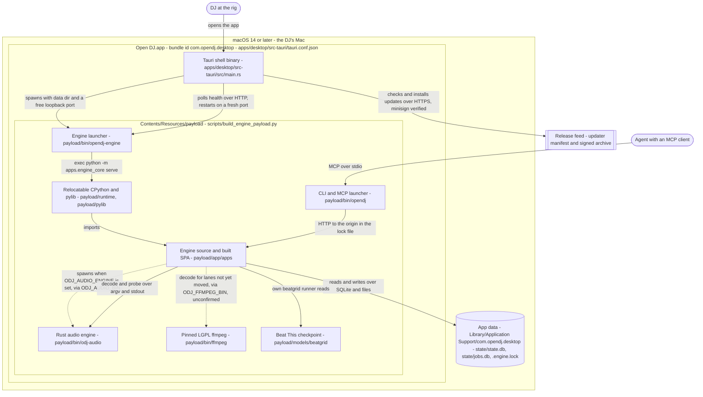
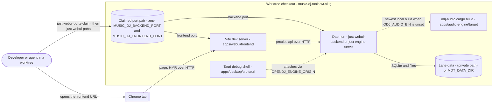

# Deployment: the packaged macOS app versus the dev loop

*Describes commit `9f36f1b426`, Tue 27 Oct 2026. Containers: [`c4-2-containers.md`](c4-2-containers.md).
Area map: [`../../moc/desktop-and-release.md`](../../moc/desktop-and-release.md).*

The same containers run in two arrangements. In the packaged app everything ships inside one
signed bundle and starts from the desktop shell. In the dev loop each container is a separate
feedback loop started from the `justfile`, on ports this worktree claims. The shipping shell is
Tauri 2; the Electron shell is built beside it and not yet in the DMG (evidence in
[`c4-2-containers.md`](c4-2-containers.md), "Which desktop shell is current").

## Packaged macOS app

### Legend

| Shape | C4 element | In this diagram |
|:------|:-----------|:----------------|
| Stadium | Person | DJ, agent |
| Subgraph | Deployment node | the Mac, the app bundle, the payload directory |
| Rectangle | Container instance or its executable | shell, launchers, runtime, engine source, odj-audio, ffmpeg, model weights |
| Cylinder | Data store | app data directory |
| Double-edged box | External system | release feed |
| Dashed arrow | Off by default, or unconfirmed | odj-audio as the playback engine, ffmpeg use |

### What is bundled

`scripts/build_engine_payload.py` stages a payload that boots the FastAPI engine on a Mac with no
repository, no uv and no Homebrew: `manifest.json` (identity, sizes, digests, safety scans),
`bin/opendj-engine` (the one entry point the shell knows), `bin/opendj` (agent CLI and MCP),
`bin/odj-audio` (built `--release --features device`), a pinned LGPL `bin/ffmpeg`,
python-build-standalone under `runtime/`, the dependency closure in `pylib/`, and the engine source
including the built SPA under `app/apps/`. The payload is a real file tree rather than a frozen
PyInstaller bundle, so path derivation and dynamic imports behave as in a checkout. The launcher
preamble exports the worker interpreters (`MDT_STEM_WORKER_PYTHON`, `MDT_VOCAL_WORKER_PYTHON`), the
beatgrid runner and weights, `ODJ_AUDIO_BIN` and `ODJ_FFMPEG_BIN`, so nothing falls back to a repo
build. `tauri.conf.json` lists the payload as a bundle resource and declares the `app` target only;
`just dmg` makes the image itself with `hdiutil`, then signs, notarizes and staples
(`scripts/ship_dmg.sh`).

### Where data lives

The shell resolves `app_data_dir()`, which is `~/Library/Application Support/<bundle identifier>`
(`apps/desktop/src-tauri/src/main.rs`), and passes it as `--data-dir`. Under it the engine keeps
`state/state.db`, `state/jobs.db` (`apps/engine_core/config.py`) and the single-instance lock
`.engine.lock` (`apps/engine_core/lock.py`). An installed app needs no checkout and no pre-started
daemon.

### How the engine is supervised

Two layers, one owner each. The **shell** owns the Python engine: start or adopt, wait for health,
inject `OPENDJ_ENGINE_ORIGIN` before bootstrap scripts run, then supervise, restarting on a fresh
port or surfacing a fatal or waiting-for-disk state rather than a fake UI (`launch.rs`,
`supervisor.rs`). The window is created with background throttling disabled so a backgrounded app
keeps playing and keeps answering agent orders (ADR-NEW-desktop-webview-never-suspended). The
**Python engine** owns `odj-audio`: spawn with a per-spawn token, restart with backoff
(`apps/engine_core/audio_engine.py`). The shell only passes the binary path.

### Auto-update

The Tauri updater plugin checks an endpoint configured in `tauri.conf.json` and verifies the archive
against the minisign public key there. `scripts/release.sh` refuses unsigned or misconfigured
releases, then publishes the archive, signature and manifest to a feed outside this repository,
and refuses to replace an existing version. The Electron shell uses `electron-updater` against the
same feed, but is not shipped (ADR-NEW-electron-desktop-shell).

## Dev loop

### Legend

| Shape | C4 element | In this diagram |
|:------|:-----------|:----------------|
| Stadium | Person | developer or agent |
| Subgraph | Deployment node | the worktree |
| Rectangle | Container instance | Vite, daemon, cargo build, Tauri debug shell |
| Cylinder | Data store | port file, lane data |
| Double-edged box | External system | Chrome |
| Dashed arrow | Optional | Rust engine, desktop shell attach |

### How the loop starts

1. `just webui-ports-claim` writes this worktree's backend and frontend ports into the ignored root
   `.env` (`apps/webui/port_config.py`); `just webui-ports` prints the URLs. Live-check before
   binding; two worktrees never share a pair.
2. `just webui-backend` runs `python -m apps.webui.server --reload` (the bare app, no chassis);
   `just engine-serve` runs `python -m apps.engine_core serve --data-dir "$MDT_DATA_DIR"` (the
   chassis, with `boot_id` in `/health`).
3. `just webui-frontend` starts Vite on the claimed frontend port and proxies `/api` to the backend.
   Chrome is the fast loop; `just webui-webkit-watch` serves a production build from the engine
   for a WebKit-accurate check.
4. Optional: `ODJ_AUDIO_ENGINE=wall` or `device` on the daemon and `?engine=rust` on the page to
   play through a local `odj-audio` build.
5. Optional: the Tauri debug shell attaches to a running engine through `OPENDJ_ENGINE_ORIGIN`
   instead of spawning one (`apps/desktop/README.md`).

`(private path)` also names `webui-backend` on 8585 and `webui-frontend` on 5173; it is
generated by `scripts/dev_server_registry.py` (`just launch-json`) and those are the default
profile's ports, not this worktree's claimed pair.

## CI and test hosts, as far as they run the product

| Where | What runs the product | Source |
|:------|:----------------------|:-------|
| Self-hosted Linux runners, chosen by repository variables, with `ubuntu-latest` as the fallback | pytest against the daemon, Playwright e2e against Vite plus the daemon, the Electron shell under Xvfb | `.github/workflows/ci.yml`, `e2e.yml`, `apps/desktop/electron/README.md` |
| macOS runners, `macos-14` fallback | Shell compile, payload and packaging checks | `.github/workflows/macos-desktop-compile.yml`, `macos-packaging.yml` |
| Windows runner, on demand and periodic | The Windows parity gate, off the per-pull-request path | `.github/workflows/windows-parity.yml`, ADR-NEW-portable-by-default-not-a-rust-rewrite |
| A macOS test host | Installed-app acceptance: the exact installed bundle in an isolated HOME proves import, deck load, audible playback, stems and lyrics, and a clean quit | `(private path)`, ADR-NEW-installed-app-acceptance-gate |

## Unconfirmed

- **Whether the packaged app ever sets `ODJ_AUDIO_ENGINE`.** I did not find it in the shell or the
  payload launchers, so odj-audio playback is drawn dashed.
- **ffmpeg.** The payload ships it although ADR-NEW-analysis-decodes-with-the-engine says not to
  bundle it; the ADR's lane-by-lane move explains the overlap, but which lanes still use it was not
  traced.
- **The update feed's host** is outside this repository and was not read.
- **Notarization and signing state** are runtime facts of the release machine and were not checked.
