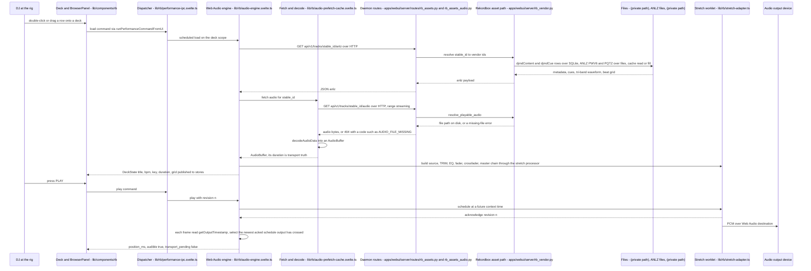
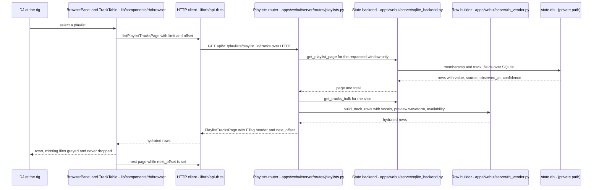

# Dynamic views: deck load to audible output, and the library read path

*Describes commit `9f36f1b426`, Tue 27 Oct 2026. Source flows:
`(private path)` (mapped Sat 15 Aug 2026), "Data flow: deck load through to
audible output" and "Data flow: library listing", checked against the code named below. Frontend
paths are relative to `apps/webui/frontend/src/`.*

Both sequences describe the default path: Web Audio in the page. The opt-in Rust engine mode is
noted after the first diagram.

## Deck load through to audible output

### Legend

| Participant | C4 element |
|:------------|:-----------|
| DJ at the rig | Person |
| Deck and BrowserPanel, Dispatcher, Web Audio engine, Fetch and decode, Stretch worklet | Components of the web UI container |
| Daemon routes, Rekordbox asset path | Components of the engine daemon container |
| Files | Data store containers |
| Audio output device | External system |

### What the code confirms

- `audio-engine.svelte.ts` states the contract in its header: `load()` fetches audio and required
  analysis via `api-rb`, then `decodeAudioData`, then the per-deck chain; a backend 404 such as
  `AUDIO_FILE_MISSING` raises a toast, sets `deckLoadErrors` and rejects, never a silent fallback;
  a failed analysis fetch rejects the load and publishes no unusable deck.
- `rb_assets.py` serves `GET /{stable_id}/anlz`; `rb_assets_audio.py` serves `GET` and `HEAD` for
  `/{stable_id}/audio` and picks the file with `rb_vendor.resolve_playable_audio`.
- `audio-prefetch-cache.svelte.ts` calls `ctx.decodeAudioData` and copies prefetched bytes so the
  cache is not detached.
- Cues come from `djmdCue`, never ANLZ PCOB or PCO2, which are empty in rekordbox 6 and 7.
- Position comes from `getOutputTimestamp()` plus acknowledged revisions, never
  `AudioContext.currentTime` (`docs/architecture/audio-timing.md`).
- For a stemmed deck the single source is replaced by `AlignedStemDeckProcessor` in
  `lib/rb/stem-graph.ts`, one stretch processor and gain per part, validated before connecting
  and scheduled with `Promise.allSettled` so a partial failure disconnects the whole group.

### Not confirmed for this diagram

- **Order of the two fetches.** The diagram shows anlz then audio, following the planning doc. The
  engine may issue them concurrently or reuse a prefetched entry (`audio-engine.svelte.ts` reuses a
  ready anlz cache entry); the exact ordering at this commit was not traced.
- **Range streaming** is named in the planning doc; whether the default load requests a range or
  the whole file was not checked.

### Rust engine mode, opt-in

With `?engine=rust`, `performance-ipc.svelte.ts` hands audio commands to `executeInRustEngine`
first. The page still fetches the same anlz for the waveform, but the load goes through
`POST /api/v1/audio-engine/load` (`apps/engine_core/audio_engine_load.py`), which resolves the same
file and beatgrid and sends a protocol v1 `load` to `odj-audio`. The engine decodes with symphonia,
renders through cpal, and reports `position_ms` and `rate` about 30 times a second over its
loopback WebSocket; the page extrapolates between reports and never runs ahead of one
(`lib/audio-engine/client.ts`, `predictPositionMs`). See
[`c4-3-components-audio-engine.md`](c4-3-components-audio-engine.md).

## Library read path

### Legend

| Participant | C4 element |
|:------------|:-----------|
| DJ at the rig | Person |
| BrowserPanel and TrackTable, HTTP client | Components of the web UI container |
| Playlists router, State backend, Row builder | Components of the engine daemon container |
| state.db | Data store container |

### What the code confirms, and what changed since the planning doc

- The planning doc describes `GET /api/v1/playlists/{id}` hydrating every row in one call. That
  route still exists (`getPlaylistHydrated` in `lib/rb/api-rb.ts`), but the paged route is now the
  first-paint path: `list_playlist_tracks` in `routes/playlists.py` reads only the requested
  window (LIBM-133), returns an `ETag`, and is called by `listPlaylistTracksPage` from
  `lib/components/rb/browser/fill-playlist-pane.ts`.
- A playlist member with no track row is a `500 PLAYLIST_MEMBER_MISSING`, not a skipped row.
- Rows for files that are not on disk are annotated, not filtered, so an agent's counts match what
  a human scrolls past (`docs/architecture.md`, the 74 percent dead paths note).

### Not confirmed for this diagram

- Whether every browser pane uses the paged route, or some still call the full hydrated detail,
  was not audited across `lib/components/rb/browser/`.
- The `?available=` filter described in the planning doc is on `GET /playlists/{id}`
  (`routes/playlists.py`); whether the paged route honors it was not checked, so it is not drawn.
